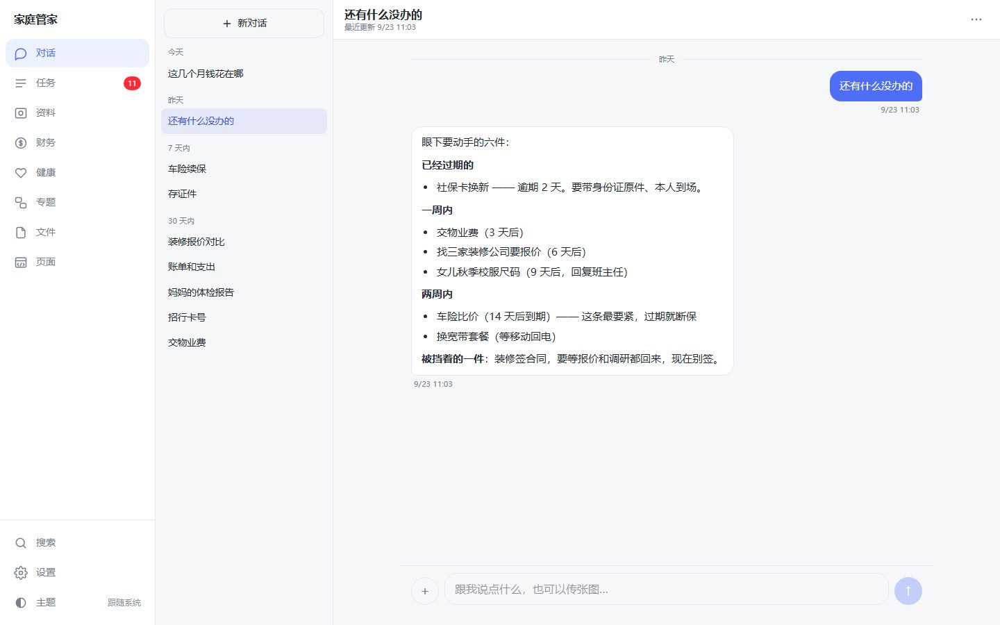
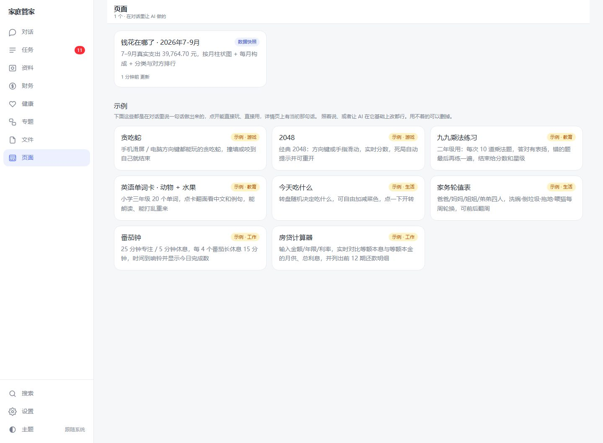
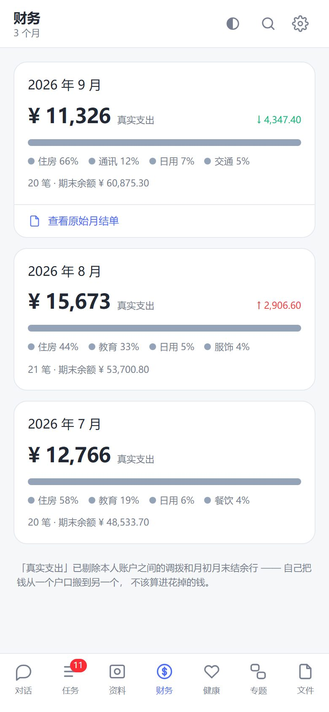

# 个人 AI 秘书（家庭管家）

**中文** | [English](README.en.md)

一个装在自己电脑上的 AI 生活秘书。你用聊天的方式交代事情，它把待办、账号、账单、
体检报告、保单分门别类存好，要用的时候一翻就有。

**数据库、上传原件和备份保存在你自己的电脑上。** 软件不收集遥测；使用 AI 时，
对话内容会传给你选择的模型服务商。启用语音后，录音或朗读正文还会发送到独立配置的阿里云语音服务，即使聊天后端选的是本机 Codex 也一样。



## 能做什么

直接跟它说话，像发微信：

| 你说 | 它做 |
| --- | --- |
| 「下周三前把车险续了」 | 建一条待办，算好截止日期 |
| 「记住我的招行卡号是 6225…」 | 存进资料库，以后问一句就能查、一键复制 |
| 「还有什么没办的」 | 查任务表，照实回答 |
| 拖一张银行账单截图进来 | 一笔笔读出来入账，**自动核对期初期末余额**，读错了会告诉你差多少 |
| 拖一张体检报告进来 | 指标一项项录进健康档案，异常项标出来，下次体检能看趋势 |
| 「做个页面看看这几个月钱花哪了」 | 查真实数据，做一张图表页面，存在「页面」栏目里 |
| 「做个贪吃蛇给孩子玩」 | 做一个能玩的小游戏（装好就带 8 个示例） |
| 「做个读书记录，记书名、作者和评分」 | 做一个能直接填写的小页面，记录存进本机数据库，关掉再开、换手机访问也能看到 |
| 「我今年读了几本书」「读书记录里加一本《三体》」 | 读取页面里已存的记录，按你的要求查询或修改同一份数据 |

另外还有：

- **Gmail 桌面试点（`0.6.0-beta.2` 测试版）**：测试包内置 Google 应用参数，点击连接即可在浏览器授权；**目前仅 Google 测试名单中的账号可连接**，其他用户可在高级设置中使用自备配置。明确允许后定期分析邮件、查看候选提醒并手动转待办；支持 API 与本机 Codex，退出应用后暂停。详见 [Gmail 桌面试点](docs/Gmail桌面试点.md)。

- **本机 Codex（v0.4.0 起）**：使用这台电脑已有的 Codex 登录进行多轮对话，调用同一套业务工具读写数据库；网页生成也使用独立 Codex 调用，不需要 DeepSeek Key。设置页可选，原 API 模式保留。详见 [本机 Codex 对话](docs/Codex本机对话.md)。**v0.4.0 安装包已包含此功能。**

- **任务专属 AI 对话（v0.4.0 起）**：每个待办详情页点「和 AI 聊这件任务」，在浮层里围绕这件事持续交流。自动带上最新要求、进展和关联资料，可更新当前任务、追加结论或创建关联的后续待办；支持 API 与本机 Codex。收起后留在原任务，同页重开保留草稿。详见 [任务专属 AI 对话](docs/任务专属AI对话.md)。

- **多个对话**：一件事一个对话，聊完自动起标题。资料、任务、页面是共用的，哪个对话里都查得到。
- **语音对话（v0.5.0 起）**：录音输入、回答朗读、连续语音和实时语音均已包含在 Windows 发布包中。实时模式支持插话，后台 Agent 办事期间仍可交谈，完成后播报真实结果。
- **保单台账**：每份保单下次交钱是哪天。
- **专题**：一件要持续跟进的事（装修、买车），挂着相关任务和「还没搞清楚的问题」。
- **用手机访问**：同一个 WiFi 下扫码配对，手机浏览器里用，添加到主屏幕就像 App。
- **家里的人**：任务能派给家里不同的人。
- **中英文界面**：设置页「界面语言」切换。英文界面下 AI 也用英文回复、英文记录。

## 语音怎么用（v0.5.0）

在「设置」中分别配置语音识别、语音朗读和实时语音的阿里云接口与密钥，再允许聊天页使用麦克风。

| 模式 | 使用方式 | 配置与说明 |
| --- | --- | --- |
| 录音输入 | 点击麦克风，结束后识别成草稿，可编辑再发送 | [语音输入 / ASR](docs/语音输入.md) |
| 回答朗读 | 对 AI 回答点击朗读，支持暂停、继续、停止 | [语音朗读 / TTS](docs/语音朗读.md) |
| 连续语音 | 自动检测停顿，依次完成识别、Agent 回答和朗读，再继续听 | [连续语音对话](docs/连续语音对话.md) |
| 实时语音 | 持续收音、流式回答，支持说话打断，查询和修改交由后台 Agent | [实时语音对话](docs/实时语音对话.md) |

实时模型默认 `qwen-audio-3.0-realtime-flash`，可切换 Plus；独立语音服务按阿里云规则计费。上传重试与播放缓冲可缓解网络抖动，但长连接仍可能中断，尚未确认全部原因。切后台或离开页面会结束语音，单次实时会话最长 30 分钟；插话不撤回已接受的后台操作。手机使用麦克风需要 HTTPS，桌面普通 HTTP 局域网访问不能保证手机录音可用。

## 网页制作与页面存储（v0.3.0 起）

- **制作网页单独调用模型**：聊天 AI 先整理需求和真实数据，再由一次独立调用制作页面，带入针对报告、游戏、学习练习等场景的设计规范。百炼和 DeepSeek 官方配置使用 `max` 推理强度，给模型更多思考空间；其他自定义服务商不强行传入该参数。
- **看得见制作进度**：制作过程中显示「正在思考」或「已写多少字」，复杂页面生成时可以了解进展。
- **页面能长期记东西**：读书记录、打卡、清单、游戏最高分等页面可使用自带存储，记录保存在本机数据库。页面和聊天 AI 读写同一份数据，不必再把记录复制进对话。
- **全屏和下载**：全屏使用时仍可保存记录；下载成单个 HTML 文件时，会带出页面已有数据。下载后的文件独立使用，不再与应用里的记录自动同步。

<p>


</p>

## 下载安装（Windows）

到 [Releases](../../releases) 下载，挑一个：

> 最新版 [v0.5.0](../../releases/tag/v0.5.0) 包含四种语音模式，并保留本机 Codex、任务专属对话和页面存储。升级步骤、验证范围与已知限制见 [发布说明](docs/releases/v0.5.0.md)。

> Gmail 测试版：[v0.6.0-beta.2](../../releases/tag/v0.6.0-beta.2)。内置连接仅向 Google 测试名单开放；稳定版仍为 v0.5.0。详见 [测试版说明](docs/releases/v0.6.0-beta.2.md)。

| 文件 | 数据放在哪 | 适合 |
| --- | --- | --- |
| `personal-ai-secretary-Setup-<版本>.exe` | `%APPDATA%\家庭管家\data\` | 大多数人。装一次，桌面和开始菜单有图标 |
| `personal-ai-secretary-<版本>-win.zip` | 解压目录里的 `data\` | 免安装。解压即用，整个文件夹拷到 U 盘能带走 |
| `personal-ai-secretary-portable-<版本>.exe` | exe 同目录的 `data\` | 单文件免安装。每次启动要先解压，冷启动慢 |

软件装好后叫「家庭管家」。

安装包没有代码签名，Windows 会提示「已保护你的电脑」—— 点 **更多信息 → 仍要运行**。
不放心的话可以按下面「从源码构建」自己打包。

目前只有 Windows 版。

## 第一次打开

1. **填 AI 模型的 key**。菜单「设置 → AI 模型 / API Key…」，选服务商、填 key，点「保存并测试」。
   - **阿里云百炼**（国内直连）：[百炼控制台](https://bailian.console.aliyun.com/) 注册后在「API-KEY」页面创建
   - **DeepSeek 官方**：[platform.deepseek.com](https://platform.deepseek.com/) 的「API keys」
   - 其他 OpenAI 兼容接口也行，自己填地址和模型名。读账单、体检报告要用**带视觉**的模型。
2. **设置 → 家里的人**：填上家里有谁，任务就能派给不同的人。
3. 去「对话」里说句话试试。

也可在「设置 → 对话后端」选择「本机 Codex」（v0.4.0 起）：先在这台电脑安装并登录 Codex，保存后开启新对话。该方式无需聊天 API Key，使用该登录的额度，仍需联网。源码本地运行时在 `.env` 启用 `ENABLE_LOCAL_CODEX=true`；桌面应用自动启用。语音功能仍需独立配置阿里云服务。

未配置任何 AI 后端时，待办、资料库这些仍能手动操作。

## 隐私

- 数据库（SQLite）、上传的原件、备份都在上面那个 `data` 文件夹里。菜单「设置 → 打开数据文件夹」直接跳过去。
- 软件本身不联网上报。**跟 AI 对话时发的文字和图片会传给你选的模型服务商** —— AI 要读到账单才能帮你录入。不想让它看的东西就别发给它，自己手动录。
- 录音输入将录音发送到 ASR，回答朗读将正文发送到 TTS，连续语音组合使用这两项服务。实时语音开启后会持续发送麦克风音频给阿里云，结束或切后台即停止。原始录音不持久保存，识别文字与处理结果按聊天和执行记录保存；本机 Codex 不替代这些云端语音服务。
- 敏感信息是**明文**存在本机数据库里的（这样 AI 才查得出来）。靠的是这台电脑本身的安全：别把 `data` 文件夹随手发给别人。
- 「用手机访问」默认关。打开后只有扫码配对过的设备能进来，配对码一次性、10 分钟过期，设备可以随时移除。

## 从源码构建

需要 Node.js 22+。

```bash
npm install
cp .env.example .env          # 本地开发配置，AI key 可以留空、之后在设置页填
npx prisma db push            # 建库
node scripts/seed-demo.mjs    # 可选：灌一份演示数据
npm run dev                   # http://localhost:3096
```

打包桌面版：

```bash
cd desktop
npm install
node scripts/prepare.mjs --no-key     # 构建 Next standalone、生成空模板库
npx electron-builder --win --x64      # 产物在 desktop/dist/
```

⚠ **一定带 `--no-key`**。不带的话 `.env` 里的 `AI_API_KEY` 会被打进安装包，
拿到安装包的人能把它抠出来。

## 目录

```
src/app/(app)/     各个页面：对话、任务、资料、财务、健康、专题、页面、文件、设置
src/app/api/chat/  对话接口（AI SDK，OpenAI 兼容）
src/lib/           agent-tools（AI 能调的工具）、数据查询、页面沙箱、导入逻辑
prisma/            数据模型
scripts/           命令行工具（secretary.mjs）、演示数据、备份
samples/pages/     「页面」栏目自带的 8 个示例
desktop/           Electron 外壳、手机访问网关（lan.js）、打包脚本
docs/              开发笔记
```

想改代码先看 [`docs/开发笔记.md`](docs/开发笔记.md) 和 [`desktop/README.md`](desktop/README.md)。

本机 Codex 已随 v0.4.0 发布，使用与验证范围见 [`本机 Codex 对话`](docs/Codex本机对话.md)。历史方案与其他后续设计留在 [`接入方案`](docs/Codex接入方案.md)。

## 现状

早期版本，作者自己家在用。

- **数据结构还会变**。升级时会尽量自动补上新字段，但暂时别把它当唯一的存档 —— 重要的东西另外留一份。
- 没有自动更新，新版本要重新下载安装（覆盖装，数据不丢）。
- 还没做：跨对话的记忆、事后让 AI 重看上传过的原件、专题和文稿接进对话。

问题和建议欢迎提 [Issue](../../issues)。这是个人项目，会看，但不保证及时回复。

## 许可证

[AGPL-3.0](LICENSE)。可以自由使用、修改、分发；**修改后的版本如果拿来对外提供服务
（包括做成网站给别人用），必须同样公开源代码。**
