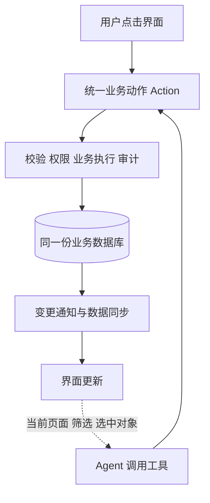

# Agent-Native 架构借鉴分析

> 状态：待讨论，暂不实施。分析日期：2026-10-16；整理日期：2026-10-17。
> 用户决定先保存分析，后续有空再讨论借鉴方式。本文件中的试点顺序、接口形态和验收条件均为讨论建议。

BuilderIO 的 Agent-Native 与本项目都让用户通过界面、AI 通过工具操作同一份业务数据。值得优先借鉴的是统一业务动作、共享当前界面上下文、按数据变化局部更新界面。建议保留本项目现有技术栈，逐步吸收这些设计。

## 参考版本与分析范围

- 参考仓库：[BuilderIO/agent-native](https://github.com/BuilderIO/agent-native)。
- 固定参考提交：[`705e23f37cb1e4762e12cfca5fb1b8feed61ae5f`](https://github.com/BuilderIO/agent-native/tree/705e23f37cb1e4762e12cfca5fb1b8feed61ae5f)。后续仓库更新可能改变实现。
- 本项目对照版本：`v0.5.0`，提交 `9dec980b648f1068dd2efc73461113a271f4f5cd`。
- 分析依据：README、Action 核心实现、应用状态与同步机制、Calendar 示例。结论来自文档和源码阅读，不代表已完成该框架的运行验收或与本项目的集成验证。

## 核心思路

Agent-Native 主要围绕三项共享能力组织应用：

1. **共享动作**：人点击按钮和 Agent 调用工具，最终进入同一个业务 Action。
2. **共享数据**：两种入口读写相同的业务记录，结果可被另一种入口读取。
3. **共享界面上下文**：Agent 获得当前页面、选中对象和筛选条件，理解用户所说的“这件事”“这些记录”。

例如“修改任务负责人”，开发者定义一次动作，界面下拉框与 Agent 工具共用其参数校验、权限规则和业务实现。框架还可将动作暴露给 HTTP、CLI、MCP、A2A 等入口；具体暴露范围可配置。

`defineAction()` 在执行函数外包装输入校验、访问检查、可选输出校验、审计及执行追踪。声明式参数和工具描述帮助模型选择并填写动作，权限检查则由服务端执行。普通按钮直接调用确定的业务操作，理解意图、规划和组合步骤由 Agent 完成。

共用动作不等于所有入口拥有相同权限。业务实现可以共享，同时保留调用者身份、任务范围、资源访问和工具暴露边界。

## 与本项目的对应关系

| 方面 | v0.5.0 现状 | 可借鉴方向 |
| --- | --- | --- |
| 业务数据 | UI、API Agent、Codex 工具使用同一 SQLite 数据库 | 保留这一基础 |
| 业务动作 | 部分能力共用函数，部分界面操作与 AI 工具分别实现 | 提取共享业务服务，统一校验和规则 |
| 界面上下文 | 任务专属聊天每轮带入当前任务的最新资料 | 扩展到资料、健康、财务和生成页面 |
| 结果同步 | 缓存失效、聊天历史同步和局部事件等机制并存 | 统一变更通知，按受影响数据更新 |
| 操作追踪 | 已有 Codex 工具执行记录、VoiceJob 和页面版本 | 逐步形成跨入口的操作回执和记录 |

当前界面的创建任务位于 [`src/app/(app)/actions.ts`](<../src/app/(app)/actions.ts>)，AI 的创建与修改任务位于 [`src/lib/agent-tools.ts`](../src/lib/agent-tools.ts)。两边包含独立的 Prisma 操作，后续增加日期校验、业务限制或审计时需要分别维护。

页面存储已有可复用的设计：[`src/lib/page-data.ts`](../src/lib/page-data.ts)同时服务生成页面和 AI 工具，两边读写同一份 PageData。它可作为其他模块统一业务实现的参考。

## 优先借鉴方向

### 统一业务动作

以待办为起点，将创建、修改、完成等操作提取为共享业务函数。界面 Server Action 负责解析表单，AI 工具负责声明模型可用的参数，CLI 负责解析命令；各入口最终调用同一个业务服务。

共享服务应集中处理输入校验、日期和状态规则、资源范围、数据库写入以及结构化结果。调用上下文应保留来源、对话和任务范围，避免统一函数时丢失已有任务专属聊天限制。

可以先实现轻量服务层，是否再加入通用 Action 注册器，留待试点后讨论。独立 ASR、TTS 和实时音频协议仍有自身的流式生命周期，不需要为了统一业务动作而合并为同一种请求。

### 让 Agent 理解当前界面

Agent-Native 用导航和选中状态表达当前界面，再通过 `view-screen` 一类动作查询最新记录。其 Calendar 示例会结合日期范围、日历视图和可见事件形成上下文。

本项目可以保留轻量的页面类型、记录 ID、筛选条件、选中项，再由服务端按需加载详细资料。例如：

- 打开一条待办，说“把这件事顺延到下周五”，Agent 能定位当前任务并读取最新状态。
- 在财务页筛选三个月的记录，问“这些支出为什么增加了”，分析沿用当前筛选范围。
- 在健康页打开一份报告，问“和上次相比有什么变化”，以当前报告为起点查询。

上下文需要区分标签页、设备与对话，并在选择取消、对象删除或页面离开时清理。浏览器传来的 ID 只是定位信息，不能替代权限和任务范围校验。当前界面上下文也不应被解释为用户已经授权执行修改。

### 按数据变化更新界面

Agent-Native 的动作查询与写入 Hook 配合变更事件更新缓存；远端变化按场景启用 SSE 或轮询。变更来源标记用于减少当前标签页对自己刚完成的操作重复刷新。

对本项目最有价值的目标是：持续语音期间，Agent 修改待办后只更新受影响的任务与列表，麦克风、播放和草稿继续保持。此前整页刷新导致语音组件退出的问题说明，业务数据更新与收音组件生命周期需要分开管理。

可考虑让操作结果携带变更对象与字段，界面按类型和 ID 更新，并短暂提示哪条记录被修改。是否需要独立 SSE、先采用现有局部事件还是轮询，需结合 Next.js、桌面内嵌服务和手机访问方式讨论。

### 处理人机同时编辑

共享数据库、共享动作和自动同步，都不自动提供并发冲突保护。

例如用户打开任务表单后，Agent 修改了截止日期；用户再保存旧表单，就可能覆盖该修改。生成页面与 Agent 读写同一份 JSON 数据时，也有类似风险。

可讨论按字段更新、版本号或更新时间条件检查，以及冲突后的提示和合并方式。发生版本冲突时应重新读取并处理，避免用旧内容无提示覆盖新结果。操作幂等与重试边界也应明确，特别是语音或网络异常后的重复请求。

## 后续可讨论能力

- **操作回执**：显示修改对象、实际变化与结果链接。已有 CodexToolRun 和 VoiceJob 可作为基础，逐步覆盖其他业务入口。
- **撤销**：仅对具备安全逆操作的业务单独设计。审计记录和操作回执本身不等于可以撤销。
- **可管理的偏好与技能**：将默认负责人、回答习惯和工作流程与任务、财务、健康等事实记录分别管理，允许用户查看和修改。
- **定时工作**：定期整理即将到期事项，保留执行状态和结果，设计重复执行与失败恢复规则。
- **具体操作确认**：对外发送等后果较大的操作可确认具体内容；普通读取与常规待办修改保持顺畅。确认不能替代权限检查。

Agent-Native 已包含较完整的平台能力，涉及 Nitro、Drizzle、PostgreSQL/PGlite 等体系。本项目的 Next.js、Prisma、SQLite、Electron、本机 Codex 和语音链路已有积累；整体迁移的成本与收益尚需单独评估，当前建议先借鉴架构契约。

## 待讨论的试点与验收

若后续决定推进，可先选择待办模块形成一条完整路径：

1. 创建、修改、完成任务共用业务服务，保持现有 UI、API 与 Codex 入口行为。
2. 接入当前任务与选中项上下文，文字和语音都能理解“这件事”。
3. 操作后局部更新界面，展示回执，并处理旧表单与并发修改。

讨论实施范围时重点确认：

- 第一轮只抽取共享业务函数，还是同时定义 Action 元数据与注册机制？
- 哪些页面需要上下文，跨设备与跨对话如何隔离？
- 同步先覆盖哪些记录和入口，如何保持实时语音组件稳定？
- 哪些字段需要版本冲突保护，哪些操作适合撤销？
- CLI、API Agent、Codex 和任务专属聊天之间如何保持能力与权限边界？

建议验收场景包括：不同入口执行相同操作时规则一致；任务专属聊天无法越出当前任务范围；人机同时编辑不会静默覆盖；Agent 修改后界面及时更新；语音中的麦克风、播放和草稿保持；网络重试不会产生重复业务记录。

## 源码与文档依据

外部链接固定到分析时的提交，便于后续复核：

- [README 与共享能力概述](https://github.com/BuilderIO/agent-native/blob/705e23f37cb1e4762e12cfca5fb1b8feed61ae5f/README.md)
- [Actions 架构与调用入口](https://github.com/BuilderIO/agent-native/blob/705e23f37cb1e4762e12cfca5fb1b8feed61ae5f/packages/core/docs/content/actions-overview.mdx)
- [defineAction 执行包装实现](https://github.com/BuilderIO/agent-native/blob/705e23f37cb1e4762e12cfca5fb1b8feed61ae5f/packages/core/src/action.ts#L634)
- [访问控制与确认机制](https://github.com/BuilderIO/agent-native/blob/705e23f37cb1e4762e12cfca5fb1b8feed61ae5f/packages/core/docs/content/actions-access-control.mdx)
- [界面上下文设计](https://github.com/BuilderIO/agent-native/blob/705e23f37cb1e4762e12cfca5fb1b8feed61ae5f/packages/core/docs/content/context-awareness.mdx)
- [数据同步实现](https://github.com/BuilderIO/agent-native/blob/705e23f37cb1e4762e12cfca5fb1b8feed61ae5f/packages/core/src/client/use-db-sync.ts)
- [Calendar 的 view-screen 示例](https://github.com/BuilderIO/agent-native/blob/705e23f37cb1e4762e12cfca5fb1b8feed61ae5f/templates/calendar/actions/view-screen.ts)
- [Agent 资源与记忆](https://github.com/BuilderIO/agent-native/blob/705e23f37cb1e4762e12cfca5fb1b8feed61ae5f/packages/core/docs/content/agent-resources.mdx)

本项目相关设计可继续参阅：[任务专属 AI 对话](任务专属AI对话.md)、[实时语音对话](实时语音对话.md)、[模块化扩展方案](模块化扩展方案.md)。
