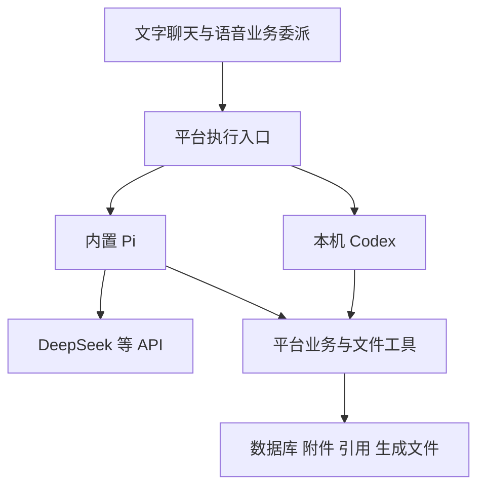

# Pi 内置 Harness 架构与试点

日期：2026-10-25。状态：首轮隔离试点通过，已接入可选的「内置 Pi（试用）」聊天后端；保留原 API 与 Codex，尚未改为默认或发布新安装包。

后续共用工具、网络搜索与文件改造按 [对话能力改造实施计划](对话能力改造实施计划.md)推进；本文保留 Pi 接入基线的验收记录。

## 架构结论

平台逐渐从数据库助手扩展到长对话、历史附件与生成文件。API 路径已经是一个由 AI SDK 和应用代码组成的自建 harness，并非完全没有运行管理；随着需求增加，继续自建会增加通用基础设施的维护成本。

采用可替换运行时：保留用户本机 Codex，试验在应用内嵌入 Pi，供填写 API Key 的用户使用。Pi 负责模型上下文、压缩、会话与工具循环；平台继续掌握业务规则、文件权限、引用及完整产品记录。Pi 不需要用户另行安装或操作终端。是否成为正式默认路径，取决于试点与桌面包验收，不在本轮直接切换。



## 职责与边界

| 职责 | 负责方 | 约束 |
| --- | --- | --- |
| 模型对话上下文、摘要压缩、运行取消、工具循环 | Codex 或 Pi | 同一运行路径只启用一套压缩和历史拼接机制 |
| 完整聊天、附件归属、业务状态、引用和审计 | 平台 | 模型摘要不能替代原文，运行时状态需参与备份、恢复和会话删除 |
| 任务、日程、资料等读写 | 共用平台工具 | 复用事务、范围保护、参数校验和写入去重，不让模型直接改数据库文件 |
| 资料读取与来源登记 | 平台文件工具 | 按附件 ID 授权，提供页码或分段定位，核验成功读取 |
| 文件处理及生成产物 | 受控工作区与工具 | 校验真实路径和文件归属，登记产物后提供下载，工作目录本身不等于沙箱 |
| PDF、DOCX、Excel 等格式能力 | 平台解析器或明确提供的处理工具 | 通用 read/write 不自动等于文档解析和可靠格式生成 |

Pi 处理无状态 DeepSeek API 时，历史仍由本机运行时组织并发送；不会令服务端自动保存会话，也不会提高模型本身的推理能力。压缩仍会产生模型请求、费用与等待时间。既有 [Responses 实测](ResponsesAPI隔离试点.md)的结论继续有效。

SDK 选型应验证含 SessionManager 和 compaction 的 coding-agent 层；仅引入 agent-core 不等于获得完整持久化与压缩能力。现有 `src/lib/chat-context.ts` 已移植 Pi 的部分压缩策略，并为中文及秘书场景调整，因此迁移也须保留这些业务要求。

## 平台文件工具的两项独立价值

私人版源码对照：2026-10-24 本机检查，引用提交 `bfba457`，原生文件试点提交 `7b1e083`。公开仓库仅保留设计与合成验证，不复制私人数据、路径配置或凭据。

### 平台原生引用

`secretary_read_file` 成功读取后，由平台附加附件身份、页码/文字位置和引用标记。模型在使用相应资料的句子后标记，后台只接受本轮成功工具审计中的来源，再检查记录存在，从数据库生成名称和链接，保存句末编号及底部来源列表。搜索候选、预览、失败读取与写入回执不能冒充原文引用。

这能证明“本轮通过工具读过该来源”，不能自动证明原文正确、全文覆盖完整或每句推理正确。Codex 原生命令读取的路径和输出，尚未与该引用登记机制自动打通。私人版合成试点中，原生 DOCX/PDF 读取内容正确但引用为空；同一线程通过平台工具复核后生成带页码引用。

### 文件业务权限

平台接收附件 ID，根据数据库判断是否属于当前任务、关联文稿/专题，或符合跨任务只读参考条件，再解析受控存储路径。操作系统的“进程可读取此路径”不代表“当前会话有权读取此附件”。扩大只读参考范围也不扩大写入范围。

私人版原生试点同样先复用附件授权，再暂存获准副本。其文档明确完整文件读取隔离尚未验收，不能把单次越界写入被拒当作全机隔离证明。Codex 与 Pi 均应通过同一平台权限和引用层，不能用引入 harness 替代它。

## 迁移原则

- 先隔离试点，再评估正式接入；保留现有 API、Codex、语音与历史记录。
- 平台会话映射到运行时会话；运行时管理模型上下文，数据库保存产品记录，避免反复追加完整历史或双重压缩。
- 显式提供模型、密钥、工作目录、工具和资源加载方式，不自动继承用户全局 Pi 的 skills、扩展、凭据与配置。
- 初期只暴露平台业务工具和受控文件工具；不默认开放 shell 或任意磁盘路径。需要代码执行时另行设计运行隔离与权限验收。
- 取消、网络错误和恢复不得重复产生业务写入；任务切换与运行时切换不能串用旧会话。
- AI SDK 可继续承担前端协议和独立模型调用，不要求一次性移除。

## 隔离试点与验收

试点依赖单独锁定，运行数据写入 Git 忽略的 `data/pi-harness-pilot/`。只使用专用 DeepSeek 环境变量、虚构任务及合成文件，不导入正式业务工具或读取正式数据库。实际请求需显式 `--live`，设请求与时间上限，不自动重复整个试验。

| 阶段 | 验证目标 | 当前状态 |
| --- | --- | --- |
| P0 | SDK、固定模型与独立配置，文字及流式事件 | 合成试点通过 |
| P1 | 持久化、独立进程恢复、会话隔离及压缩后事实保留 | 合成试点通过，压缩保留策略仍需产品调优 |
| P2 | 模拟业务工具、读写分离、调用去重与范围拒绝 | 已复用正式平台事务与执行审计，隔离 SQLite 验证通过 |
| P3 | 合成附件读取、平台引用登记、生成文件回读及路径越界拒绝 | 已接正式附件及下载接口；文本、文字 PDF 和范围负例通过 |
| P4 | 正式工具适配、UI/语音委派、旧历史导入与 Windows 安装包验收 | 可选后端已接通；Electron standalone 验证通过，旧对话不迁移，安装包与麦克风人工验收待做 |

通过 P0–P3 只说明内置运行时在所测条件下可用，不代表真实文件格式、完整沙箱、所有重试场景或桌面交付已完成。后续以同模型、同工具和同资料比较现有路径的正确性、延迟、用量及维护成本，再决定默认实现。

## 首轮实测结果

入口：[独立试点](../experiments/pi-harness/README.md)。固定 Pi 1.4.0，Node 24.19.0，官方 `deepseek-flash` 经 Chat Completions 调用。根 package.json / lockfile、业务数据库、正式模型设置及 Codex 线程均未修改。

| 检查 | 结果与证据 |
| --- | --- |
| 文字与流式事件 | 成功返回 OK，实际收到文字增量 |
| 自动压缩 | 本地测试窗口 8,192、预留 2,048、保留最近 1,024 token；输入回执达到 10,633 token 时生成摘要，随机标记准确保留。这是人为缩小的运行时预算，服务商真实窗口未触顶 |
| 独立进程恢复 | 关闭父进程中的 session，新 Node 进程从 JSONL 打开同一会话，只提问、不重传标记，准确回忆；session ID 未变 |
| 业务工具 | 模型调用模拟创建任务，后续回答包含实际保存的 ID 和标题；同一 requestId 在 host 重建后仍只产生一条任务，参数变更被拒 |
| 附件及引用 | 按 task-a 附件 ID 读取，回答携带本轮服务端生成标记，原型核验并登记一条来源；本次仅文本合成文件 |
| 生成文件 | 写出并回读 71 字节的 quote-summary.txt，金额 288 元、含运费、未发货；原附件哈希未变，读取流程没有新增业务任务 |
| 范围隔离 | task-b 附件及 ../ 输出路径被拒；新会话不知道旧随机标记 |
| 取消及负例 | 离线真实 SDK 测试验证取消无业务写入/网络重试；覆盖伪造及旧引用、路径、覆盖、链接文件与跨任务产物 |

首次脚本对压缩完成的判定未通过，但 JSONL 已保存有效摘要；修正判定后复用了已回执的会话，没有重发种子或长填充。原始未完成报告单独保留。基础试点共 11 次 POST。

### 压缩效果的补充验证

第一次自动压缩只总结了较早的标记消息，最近的大段填充仍被保留。Pi 按消息/轮次边界切分，保留最近内容的策略会影响实际缩减，不能把“生成摘要”直接等同于“后续输入已变短”。最近内容不足以推动切点时，显式压缩也可能在本地返回 Nothing to compact；本轮遇到的这类前置失败没有发送 HTTP 请求。

在同一会话继续验证，将**测试**保留量降为 128 token，显式压缩产生两次摘要请求，再用一次请求回忆。序列化模型上下文从 **55,387 字节降至 7,857 字节**，约减少 86%；压缩后仍能准确说出随机标记、任务 ID、标题及报价金额，没有再次调用业务工具。回忆请求实际输入为 1,819 token。字节缩减不作为延迟提升或正式长会话质量的证明；128 也不是建议的产品配置。

累计 **14 次 POST，均 HTTP 200**，未自动重试。持久化回执合计输入 **104,206 token**、输出 **1,540 token**、总计 **105,746 token**，含压缩；两次拆分摘要在 Pi 中合并为一条用量回执。费用以账号账单为准，试点价格占位值不代表零费用。

8 项离线测试通过，包含真实 SDK 的工具循环、持久化、自动/显式压缩和取消。没有用假服务结果代替上述真实模型结果。本机证据：`data/pi-harness-pilot/2026-10-24T15-29-08-281Z/report.json`、同目录 sessions、http-ledger.json 与 outputs；原始运行数据不随 Git 发布。

首轮结果支持继续尝试平台适配层。下面记录已落地的第二阶段；保留原路径与自建上下文代码，避免影响已有对话。

## 第二阶段：可选正式聊天后端

### 使用方式

1. 设置页填好 API 地址、密钥和模型。已实测 DeepSeek 官方 `deepseek-flash`。
2. 在「对话后端」选择「内置 Pi（试用）」并保存。默认上下文窗口为 128,000 token，可调整但不得超过模型实际支持值；工具定义、系统提示和回复也占窗口。
3. 开启一个新对话。任务对话也按首次创建时的后端保存；设置变更不会替换现有对话的后端或记忆。

Pi 依赖固定为 `@earendil-works/pi-coding-agent@1.4.0` 与 `@earendil-works/pi-ai@1.4.0`。源码要求 Node >=22.19；本机 Electron 内置 Node 22.22.0 已验证。无需用户另装 Pi 或终端工具。

### 已实现的边界

- `src/lib/pi/chat.ts` 将 Pi 事件映射成现有 UI SSE；文字、任务对话和实时语音后台委派共用 `runChat`。Pi 分支跳过 `prepareContext`，避免平台和 Pi 同时压缩。语音的显示记录使用用户原文。
- `src/lib/agent-turns.ts` 统一 Codex/Pi 的请求接纳、状态、取消、工具事务和审计。继续使用历史表名 `CodexTurn` / `CodexToolRun`，不迁移既有 SQL 数据。请求 ID + 输入哈希去重；同轮工具 ID + 参数去重；更换参数的重复 ID 被拒。它们不保证不同请求 ID、不同工具 ID 的语义重复自动去重。
- 模型流断开后执行仍归后台管理。刷新页面可轮询状态；手动取消中止 Pi 请求。业务写入与成功审计同事务，取消前后检查 signal；生成页面的流式网络工作仍在事务外，失败时须查看已保存结果。
- 会话独立保存在 `UPLOAD_DIR/../pi-sessions/<conversationId>/`，manifest 映射到 SDK JSONL。每轮刷新系统提示和任务范围，不重拼整串数据库历史。服务重启将未完成回执标失败，不自动重做；新的用户请求会提醒模型先核对已有结果。
- API 地址或模型改变时，旧 Pi 会话拒绝静默切换，须新建对话；同地址同模型的密钥轮换可以继续。manifest 缺失而 JSONL 仍在时拒绝重建，避免看似正常但丢失记忆。
- 不继承全局 Pi 凭据、skills、扩展或 AGENTS；仅显式平台工具可用，没有 shell、通用 read/write/edit。网络请求不自动重试，单轮上限 48 次模型请求、32 次平台工具调用，每次模型请求最多 120 秒。单次过大输入在发送前拒绝；自动压缩仍由 Pi 执行。

### 平台文件与引用

`listAttachments`、`readAttachment`、`createOutputFile`、`readConversationHistory` 由平台提供。通用对话可读本应用附件；任务对话仅能读当前任务或当前对话附件。工具不接受任意磁盘路径，核验真实路径在 uploads 内、普通文件、大小不超过 25 MB，拒绝文件符号链接与硬链接。此限制不等于操作系统沙箱。

读取成功后，服务器生成本轮随机引用 token，绑定附件 ID、文字位置或 PDF 页码与文件 SHA-256。回答中的 `[[cite:token]]` 流式转换成编号下载链接，末尾追加来源列表；未知或旧轮 token 显示“来源未核实”。回复完成前再次核验来源权限与文件版本。已有源文件不会被覆盖；新输出仅支持 `.txt/.md/.json/.csv`，登记到助手消息，支持刷新后下载。上传归档后分类/导入复用原附件 ID，避免重复文件与引用失效。

文字 PDF 按页提取、文本每次最多 12,000 字，支持续读。DOCX/XLSX 复用现有提取器，其截断说明仍有效；历史扫描件与图片不在这个文字工具中 OCR，需要本轮上传并使用视觉模型。引用只能证明本轮确实读过该来源，不能证明内容本身、全文覆盖或模型推理正确。

删除对话一并清理对应 Pi 会话目录。备份脚本纳入 pi-sessions，发现 Pi 正在处理或备份期间发生变动时拒绝产生这次备份；恢复时先关闭应用，将数据库、uploads 和 pi-sessions 一起恢复。

### 第二阶段验证与剩余验收

- 源码类型检查、i18n 对账与生产 standalone 构建通过；根 scripts 下 99 项测试全部通过，覆盖既有 Codex、语音与 Gmail 回归。
- `scripts/pi-runtime.test.mjs`：实际 SDK 的持久化、配置变动拒绝、取消、自动压缩与分块引用校验。压缩使用合成服务；此前真实 DeepSeek 压缩证据仍见首轮记录。
- `scripts/pi-platform.test.mjs`：隔离 SQLite 上的真实事务、重复执行、取消回滚、进程恢复回执、文本分页、PDF 页码、文件版本变化、跨任务/路径/硬链接拒绝，以及实际备份恢复。
- `scripts/pi-integration.mjs`：启动实际 Next 服务和合成模型，验证待办写入、请求重放、归档 ID 复用、引用、真实文件下载、取消与进程恢复。standalone 使用 Electron Node 并阻断从源码 node_modules 借用依赖。
- 最终 Electron standalone 复验通过，还验证了“业务工具已提交、回复未结束时进程被终止”：重启将回执标失败，重放原请求不调用模型，新请求继续原会话且不重复写入。初始会话在首条消息前取消也可恢复。最终回执：`data/pi-integration/2026-10-24T17-16-58-474Z/receipt.json`。
- DeepSeek 官方经实际聊天接口完成待办创建、归档、附件引用、文件生成；重启 Next 后准确回忆随机标记。共 11 次实际模型请求、75,970 total token（包括缓存计数，以服务商账单为准）。第一次脚本在越权案例上断言失败：模型直接拒绝、没有发起读取；已检查保存的数据库和 JSONL 证据，没有重复已完成的付费请求。强制隔离由确定性模型测试与平台工具负例验证。

实测回执位于 Git 忽略的 `data/pi-integration/`；真实模型两段证据分别为 `2026-10-24T16-55-12-518Z/receipt.json` 和 `2026-10-24T17-03-05-317Z/receipt.json`（UTC 文件名）。全部使用合成业务资料、隔离数据库与上传目录，没有修改正式模型设置、业务数据库或 Codex 线程。

暂不导入或转换已有 API/Codex 对话，不删除自建 harness。实时语音沿用现有 SSE 消费协议并有回归测试，本轮没有使用真人麦克风完成端到端试听。尚未构建/发布新 NSIS 安装包，也未做全新 Windows 用户安装验收；完成这些后再决定默认切换与发布。

复验命令（默认合成模型，不产生 API 费用）：

```bash
npm run test:pi
npm run test:pi:integration                    # 独立 Next dev + SQLite
npm run test:pi:integration -- --build --electron  # 独立 standalone + Electron Node
```

集成测试使用 `.next-pi-qa/`，不覆盖正常 `.next/`。显式 `--live` 才通过本机专用 DeepSeek 密钥调用官方服务，限制最多 16 次请求；`--live --followup` 只做两轮独立进程记忆复验。不要把原始数据库、会话或日志提交到 Git。

## M2B：按需业务原文与增强历史查询（2026-10-27）

Pi 每轮更新现有 session 的平台工具，不迁移或重建会话。任务资料改为轻量预览：需求 400 字符、结果 300 字符、关联文稿/专题元数据和版本、最近 5 条留言（各 300 字符）、最近 10 个附件元数据及完整数量。前置/后续任务仍保留元数据，不宣称整个快照有固定字节上限。

完整内容通过共用 `agent-records.ts` 工具读取，单次最多 6,000 字符，续读携带原版本。历史列表支持关键词、ISO 时间范围及固定上界游标；单条历史可完整续读。业务留言与聊天记录分别查询，不将聊天摘要当成原文或新写入授权。引用由平台登记并在回复保存前复核原文版本与当前权限。

旧 API 的上下文与历史逻辑保留；Codex 按工具档案 0/1/2 处理兼容性，详见 [本机 Codex 对话](Codex本机对话.md)。M2B 的验收记录与限制统一维护在 [实施计划](对话能力改造实施计划.md)，不将本阶段文本能力计作 M3 图文解析或 M4 语义检索完成。

复验新增：`node scripts/pi-integration.mjs --build --electron --records`（合成模型，通用/任务及恢复后工具链）；已有隔离构建时使用 `--standalone`。`--standalone --electron --records --live` 使用专用 DeepSeek key 验证任务聊天两轮，仍限制最多 16 次模型请求，只有合成业务内容外传。

## 参考

- [Pi SDK](https://github.com/earendil-works/pi/blob/main/packages/coding-agent/docs/sdk.md)：内嵌、会话、工具与资源控制。
- [Pi Compaction](https://github.com/earendil-works/pi/blob/main/packages/coding-agent/docs/compaction.md)：自动压缩、持久化与恢复。
- [Pi read 实现](https://github.com/earendil-works/pi/blob/main/packages/coding-agent/src/core/tools/read.ts)：通用文本/图片读取与可替换操作。
- [AI 对话功能对齐与接口演进计划](AI对话功能对齐与接口演进计划.md)：资料工具、引用、检索与恢复的既有清单。
