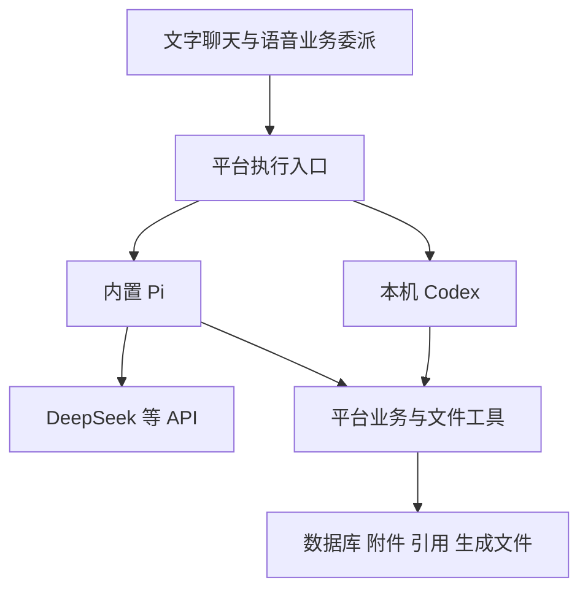

# Pi 内置 Harness 架构与试点

日期：2026-10-24。状态：架构结论已记录，首轮 Pi 隔离试点及压缩补充验证通过；正式聊天仍使用现有 AI SDK / Codex 路径。

## 架构结论

平台逐渐从数据库助手扩展到长对话、历史附件与生成文件。API 路径已经是一个由 AI SDK 和应用代码组成的自建 harness，并非完全没有运行管理；随着需求增加，继续自建会增加通用基础设施的维护成本。

采用可替换运行时：保留用户本机 Codex，试验在应用内嵌入 Pi，供填写 API Key 的用户使用。Pi 负责模型上下文、压缩、会话与工具循环；平台继续掌握业务规则、文件权限、引用及完整产品记录。Pi 不需要用户另行安装或操作终端。是否成为正式默认路径，取决于试点与桌面包验收，不在本轮直接切换。

## 职责与边界

| 职责 | 负责方 | 约束 |
| --- | --- | --- |
| 模型对话上下文、摘要压缩、运行取消、工具循环 | Codex 或 Pi | 同一运行路径只启用一套压缩和历史拼接机制 |
| 完整聊天、附件归属、业务状态、引用和审计 | 平台 | 模型摘要不能替代原文，运行时状态需参与备份、恢复和会话删除 |
| 任务、日程、资料等读写 | 共用平台工具 | 复用事务、范围保护、参数校验和写入去重，不让模型直接改数据库文件 |
| 资料读取与来源登记 | 平台文件工具 | 按附件 ID 授权，提供页码或分段定位，核验成功读取 |
| 文件处理及生成产物 | 受控工作区与工具 | 校验真实路径和文件归属，登记产物后提供下载，工作目录本身不等于沙箱 |
| PDF、DOCX、Excel 等格式能力 | 平台解析器或明确提供的处理工具 | 通用 read/write 不自动等于文档解析和可靠格式生成 |

Pi 处理无状态 DeepSeek API 时，历史仍由本机运行时组织并发送；不会令服务端自动保存会话，也不会提高模型本身的推理能力。压缩仍会产生模型请求、费用与等待时间。既有 [Responses 实测](ResponsesAPI隔离试点.md)的结论继续有效。

SDK 选型应验证含 SessionManager 和 compaction 的 coding-agent 层；仅引入 agent-core 不等于获得完整持久化与压缩能力。现有 `src/lib/chat-context.ts` 已移植 Pi 的部分压缩策略，并为中文及秘书场景调整，因此迁移也须保留这些业务要求。

## 平台文件工具的两项独立价值

私人版源码对照：2026-10-24 本机检查，引用提交 `bfba457`，原生文件试点提交 `7b1e083`。公开仓库仅保留设计与合成验证，不复制私人数据、路径配置或凭据。

### 平台原生引用

`secretary_read_file` 成功读取后，由平台附加附件身份、页码/文字位置和引用标记。模型在使用相应资料的句子后标记，后台只接受本轮成功工具审计中的来源，再检查记录存在，从数据库生成名称和链接，保存句末编号及底部来源列表。搜索候选、预览、失败读取与写入回执不能冒充原文引用。

这能证明“本轮通过工具读过该来源”，不能自动证明原文正确、全文覆盖完整或每句推理正确。Codex 原生命令读取的路径和输出，尚未与该引用登记机制自动打通。私人版合成试点中，原生 DOCX/PDF 读取内容正确但引用为空；同一线程通过平台工具复核后生成带页码引用。

### 文件业务权限

平台接收附件 ID，根据数据库判断是否属于当前任务、关联文稿/专题，或符合跨任务只读参考条件，再解析受控存储路径。操作系统的“进程可读取此路径”不代表“当前会话有权读取此附件”。扩大只读参考范围也不扩大写入范围。

私人版原生试点同样先复用附件授权，再暂存获准副本。其文档明确完整文件读取隔离尚未验收，不能把单次越界写入被拒当作全机隔离证明。Codex 与 Pi 均应通过同一平台权限和引用层，不能用引入 harness 替代它。

## 迁移原则

- 先隔离试点，再评估正式接入；保留现有 API、Codex、语音与历史记录。
- 平台会话映射到运行时会话；运行时管理模型上下文，数据库保存产品记录，避免反复追加完整历史或双重压缩。
- 显式提供模型、密钥、工作目录、工具和资源加载方式，不自动继承用户全局 Pi 的 skills、扩展、凭据与配置。
- 初期只暴露平台业务工具和受控文件工具；不默认开放 shell 或任意磁盘路径。需要代码执行时另行设计运行隔离与权限验收。
- 取消、网络错误和恢复不得重复产生业务写入；任务切换与运行时切换不能串用旧会话。
- AI SDK 可继续承担前端协议和独立模型调用，不要求一次性移除。

## 隔离试点与验收

试点依赖单独锁定，运行数据写入 Git 忽略的 `data/pi-harness-pilot/`。只使用专用 DeepSeek 环境变量、虚构任务及合成文件，不导入正式业务工具或读取正式数据库。实际请求需显式 `--live`，设请求与时间上限，不自动重复整个试验。

| 阶段 | 验证目标 | 当前状态 |
| --- | --- | --- |
| P0 | SDK、固定模型与独立配置，文字及流式事件 | 合成试点通过 |
| P1 | 持久化、独立进程恢复、会话隔离及压缩后事实保留 | 合成试点通过，压缩保留策略仍需产品调优 |
| P2 | 模拟业务工具、读写分离、调用去重与范围拒绝 | 合成试点通过，未替换正式事务与审计 |
| P3 | 合成附件读取、平台引用登记、生成文件回读及路径越界拒绝 | 原型通过，未接正式引用 UI 与业务附件 |
| P4 | 正式工具适配、UI/语音委派、旧历史导入与 Windows 安装包验收 | 本轮不迁移，后续验证 |

通过 P0–P3 只说明内置运行时在所测条件下可用，不代表真实文件格式、完整沙箱、所有重试场景或桌面交付已完成。后续以同模型、同工具和同资料比较现有路径的正确性、延迟、用量及维护成本，再决定默认实现。

## 首轮实测结果

入口：[独立试点](../experiments/pi-harness/README.md)。固定 Pi 1.4.0，Node 24.19.0，官方 `deepseek-flash` 经 Chat Completions 调用。根 package.json / lockfile、业务数据库、正式模型设置及 Codex 线程均未修改。

| 检查 | 结果与证据 |
| --- | --- |
| 文字与流式事件 | 成功返回 OK，实际收到文字增量 |
| 自动压缩 | 本地测试窗口 8,192、预留 2,048、保留最近 1,024 token；输入回执达到 10,633 token 时生成摘要，随机标记准确保留。这是人为缩小的运行时预算，服务商真实窗口未触顶 |
| 独立进程恢复 | 关闭父进程中的 session，新 Node 进程从 JSONL 打开同一会话，只提问、不重传标记，准确回忆；session ID 未变 |
| 业务工具 | 模型调用模拟创建任务，后续回答包含实际保存的 ID 和标题；同一 requestId 在 host 重建后仍只产生一条任务，参数变更被拒 |
| 附件及引用 | 按 task-a 附件 ID 读取，回答携带本轮服务端生成标记，原型核验并登记一条来源；本次仅文本合成文件 |
| 生成文件 | 写出并回读 71 字节的 quote-summary.txt，金额 288 元、含运费、未发货；原附件哈希未变，读取流程没有新增业务任务 |
| 范围隔离 | task-b 附件及 ../ 输出路径被拒；新会话不知道旧随机标记 |
| 取消及负例 | 离线真实 SDK 测试验证取消无业务写入/网络重试；覆盖伪造及旧引用、路径、覆盖、链接文件与跨任务产物 |

首次脚本对压缩完成的判定未通过，但 JSONL 已保存有效摘要；修正判定后复用了已回执的会话，没有重发种子或长填充。原始未完成报告单独保留。基础试点共 11 次 POST。

### 压缩效果的补充验证

第一次自动压缩只总结了较早的标记消息，最近的大段填充仍被保留。Pi 按消息/轮次边界切分，保留最近内容的策略会影响实际缩减，不能把“生成摘要”直接等同于“后续输入已变短”。最近内容不足以推动切点时，显式压缩也可能在本地返回 Nothing to compact；本轮遇到的这类前置失败没有发送 HTTP 请求。

在同一会话继续验证，将**测试**保留量降为 128 token，显式压缩产生两次摘要请求，再用一次请求回忆。序列化模型上下文从 **55,387 字节降至 7,857 字节**，约减少 86%；压缩后仍能准确说出随机标记、任务 ID、标题及报价金额，没有再次调用业务工具。回忆请求实际输入为 1,819 token。字节缩减不作为延迟提升或正式长会话质量的证明；128 也不是建议的产品配置。

累计 **14 次 POST，均 HTTP 200**，未自动重试。持久化回执合计输入 **104,206 token**、输出 **1,540 token**、总计 **105,746 token**，含压缩；两次拆分摘要在 Pi 中合并为一条用量回执。费用以账号账单为准，试点价格占位值不代表零费用。

8 项离线测试通过，包含真实 SDK 的工具循环、持久化、自动/显式压缩和取消。没有用假服务结果代替上述真实模型结果。本机证据：`data/pi-harness-pilot/2026-10-24T15-29-08-281Z/report.json`、同目录 sessions、http-ledger.json 与 outputs；原始运行数据不随 Git 发布。

首轮结果支持继续尝试平台适配层。下一步应先统一业务工具执行与引用审计，映射平台会话和 Pi SessionManager，验证失败/取消/重启，再接 UI 与语音；保留原路径至桌面包验收完成，不直接删除现有上下文代码。

## 参考

- [Pi SDK](https://github.com/earendil-works/pi/blob/main/packages/coding-agent/docs/sdk.md)：内嵌、会话、工具与资源控制。
- [Pi Compaction](https://github.com/earendil-works/pi/blob/main/packages/coding-agent/docs/compaction.md)：自动压缩、持久化与恢复。
- [Pi read 实现](https://github.com/earendil-works/pi/blob/main/packages/coding-agent/src/core/tools/read.ts)：通用文本/图片读取与可替换操作。
- [AI 对话功能对齐与接口演进计划](AI对话功能对齐与接口演进计划.md)：资料工具、引用、检索与恢复的既有清单。
