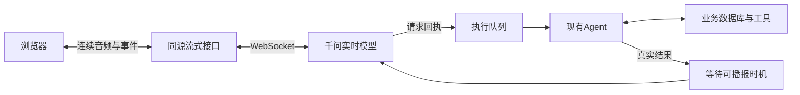

# 实时语音对话

在「设置 → 实时语音」配置阿里云密钥，在主聊天或任务聊天点击「开启实时语音」。允许麦克风后即可持续交谈，也可以在 AI 说话时直接插话。原有文字、手动录音、回答朗读和轮流式连续语音仍可使用；同一时间只开启一种收音模式。

默认配置：

```dotenv
REALTIME_API_KEY=""
REALTIME_BASE_URL="wss://dashscope.aliyuncs.com/api-ws/v1/realtime"
REALTIME_MODEL="qwen-audio-3.0-realtime-plus"
REALTIME_VOICE="longanqian"
```

支持 Plus、Flash 两个 Qwen Audio 3.0 Realtime 模型。设置页优先于环境变量；未设置独立密钥时仅接受 `DASHSCOPE_API_KEY` 环境变量，不自动复用聊天、ASR 或 TTS 配置。密钥和服务地址须属于同一区域。实时模式由模型直接接收和生成音频，不调用原来的独立 ASR/TTS 路由。

## 交谈与办事



- 实时模型负责交谈、理解指代和简短回应。个人资料、日程、待办、健康、财务等事实查询和修改交给现有 Agent。
- `submit_agent_request` 返回接受回执后即可继续交谈，完成结果稍后播报。接受不代表执行成功。
- API 与本机 Codex 共用原有业务入口、任务范围限制和持久化机制。`VoiceJob` 保存原始识别文字、转达请求、执行状态及结果，与待办 `Task` 独立。
- 后台同时收到语音原文和对指代的补充理解，并以原文及用户明确约束为准，减少转达时遗漏字段或多项要求的风险。
- 同一对话的语音工作串行执行，最多五条待处理请求。同一语音轮次重复的工具调用只认领同一条执行记录。
- 阿里云可能先发送工具调用，随后才完成识别。服务端最多等待六秒对应的最终转写；文字缺失、轮次已被后续发言替代或会话已关闭时不接受新操作。
- 后台结果在用户说完、当前生成和播放完成后再播报。只有客户端报告实际开始播放，才标记结果已播报。重连会恢复未播报结果及仍在运行工作的结果，不重新执行工作。

插话只停止当前生成和播放，不取消后台工作。本版本不提供语音撤回业务操作；用户提出取消时助手须如实说明当前能力，不能声称已经撤回。服务重启时尚未完成的执行记录标记失败，并提示部分操作可能已保存，不会自动重发。

## 音频与部署

浏览器使用 AudioWorklet 采集单声道音频，连续重采样为 16kHz PCM16，以约 160ms 的块通过同源 HTTP PATCH 发送。服务端维持到阿里云的 WebSocket，下行通过一个 SSE 流返回 24kHz PCM 与文本事件；Web Audio 按连续时间轴播放，收到插话事件立即清空播放队列并丢弃旧回答的迟到音频。

浏览器侧使用同源 HTTP 流是为了兼容现有 `next dev`、`next start`、standalone 桌面服务及手机访问转发，不要求另开公共端口或替换启动器。服务端仅持有云密钥；浏览器从不接收密钥或任意上游协议发送权限。

需要持续运行的 Node 实例和 HTTPS（或 localhost）。反向代理须关闭 `/api/realtime` 下行缓冲，并允许长连接；响应已设置 `X-Accel-Buffering: no`、`Cache-Control: no-store, no-transform`。不要部署到会冻结进程或将连续请求分派到不同进程的无状态 serverless/多实例服务；当前会话和队列由单个 Node 进程持有。

上传拥塞时最多积压约半秒音频，超限结束会话；单次会话最多三十分钟，约十二秒没有上传活动即清理。不会通过反复重连自动重发音频或后台请求。

## 数据与退出

开启期间麦克风音频持续发送阿里云，包括安静时的音频。页面明确显示该行为。原始录音不持久保存；普通完整交谈写入聊天记录，业务请求的原始转写和执行结果保存在本机数据库。被打断的未完成交谈可能不形成完整聊天记录。

点击结束、离开聊天、收起任务聊天、切后台、麦克风失效、音频被系统暂停或网络异常时，停止收音与播放、断开实时连接。草稿和附件保留。已经接受的后台工作继续执行，结果可在聊天及下次实时会话中查看。

扬声器场景使用浏览器回声消除；耳机、iPhone Safari、嘈杂环境和网络抖动仍需实机体验。当前不含唤醒词、后台聆听、远程电话或完整的业务撤回机制。

## 参考与验证

架构参考 [QwenAudio/qwen-audio-agent](https://github.com/QwenAudio/qwen-audio-agent) 的前台语音、后台工作、结果插入窗口和播放回执设计；评估时固定提交 `b6a80d45745103aa0f9e4c1fb88be6dee1b7719f`。本实现使用现有项目的业务和存储体系，没有引入整套运行时。

自动验证：

```sh
node --test scripts/realtime-voice.test.mjs scripts/realtime-route.test.mjs scripts/voice-conversation.test.mjs scripts/tts.test.mjs scripts/asr.test.mjs scripts/task-chat-scope.test.mjs scripts/codex-protocol.test.mjs
node scripts/i18n-check.mjs
npm run build
```

真实云服务和浏览器验收使用独立数据库、虚构合成录音与独立静音浏览器。正式业务数据库未参与验收。

2026-10-15 验收：生产构建、类型检查、中英文检查与 39 项测试通过。真实 Edge → 千问实时模型 → DeepSeek Agent → SQLite → 语音结果链路通过；一次语音请求对应一条执行回执和一条新待办，日期为 2026-10-16，详情保留下午三点。最终结果的真实 Web Audio 播放开始/结束回执均已收到，播完恢复聆听。

浏览器模拟服务验收覆盖双工收音、流式播放、插话清空与迟到音频忽略、手动输入互斥、权限拒绝、无效流响应及切后台清理。390×844、320×740 视口无横向溢出；结束后音轨 ended、音频上下文 closed，草稿原样保留。

任务聊天浮层验收确认请求携带其持久化的 conversationId / taskId，关闭浮层后音轨和音频上下文全部释放。
