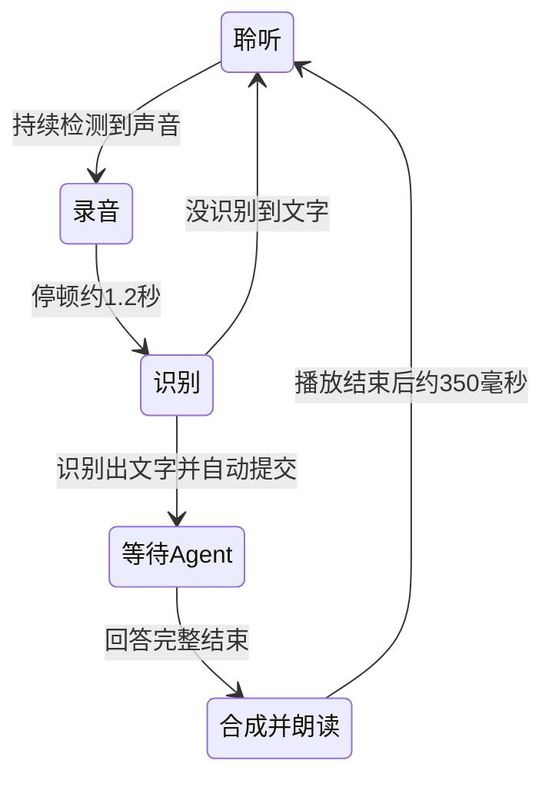

# 连续语音对话

在主聊天或任务聊天点击「开启语音对话」，允许麦克风后进入连续模式：

一次开启后无需每轮点击录音、发送或播放。识别文字作为用户消息，沿用现有 Agent 和业务工具，自动执行与普通聊天相同的处理。开启表示允许识别文字自动提交；日期、人名、金额等仍可能识别有误，可在后续对话中纠正。

第一版采用轮流说话：ASR、等待 Agent、TTS 期间麦克风轨道静音，AI 朗读时不接收插话。播完后自动恢复收音。开始其他连续语音会话会结束原会话；连续模式中手动录音和手动朗读禁用。原有草稿、附件保留，不拼入语音消息。

## 检测与音频

- 通过 AudioWorklet 在本机处理 20ms PCM 帧，输出静音以免直接回放麦克风。
- 使用轻量能量检测和自适应噪声门限，连续约 120ms 超过门限才启动，保留约 300ms 句首预录；有效发声不足 300ms 的短脉冲丢弃。
- 停顿约 1.2 秒自动结束，连续发声约 60 秒自动提交。尾部仅保留少量静音，统一转换为既有 ASR 接口支持的 16kHz 单声道 WAV。
- 安静时不上传音频；只有检测出的有效片段发送阿里云 ASR。它不是语义级的神经网络 VAD，电视、音乐或持续噪声仍可能触发，较长的思考停顿可能提前结束一句。
- 首次点击内解锁一个 AudioContext，后续通过同一上下文解码并播放 TTS，以避免每轮重新触发手机播放授权。长回答沿用现有正文清理和分段 TTS。

## 结束、异常与边界

点击「退出语音对话」、关闭任务聊天、离开当前聊天、页面隐藏或浏览器音频被系统暂停时，停止麦克风与本机播放，释放音频资源。切回页面不会偷偷重新开始监听，需要再次点击开启。

退出只结束语音模式；已经提交给 Agent 的请求继续按原有聊天机制处理，不会撤回已完成的业务写入。异常和超时不会自动重发请求，以免重复创建任务。ASR 没识别到文字会继续听；网络、Agent、TTS 异常会结束模式并展示错误，聊天里的文字和处理结果保留。

支持 API 和本机 Codex 对话后端，等待本轮完整回答后再朗读，不朗读思考过程、工具 JSON 或以前的回答。

需要 HTTPS 或 localhost、麦克风权限，以及 AudioWorklet / Web Audio 支持。第一版不支持后台持续收音、唤醒词和语音打断。真实 iPhone Safari、噪声环境与扬声器回声需实机验收。ASR 和 TTS 沿用已有独立配置，不新增云服务。

## 验证记录

2026-10-15：生产构建、中英文检查和 26 项回归测试通过；包含静音/短脉冲不提交、句首保留、停顿/时长限制、多采样率、Worklet 静音输出和独占会话控制。隔离 Edge 通过一次开启完成两轮真实阿里云 ASR/TTS 自动循环，验证草稿保留、等待/播放期间静音、播放后自动继续监听和退出清理。

另外在隔离数据库中跑过一次完整真实 ASR → DeepSeek Agent → TTS：Agent 将虚构录音中的开会提醒写成一条任务，数据库核对仅新增一次，并保留日期与“下午三点”详情。真实业务数据库未参与测试，临时聊天模型凭据已从测试库移除。

浏览器模拟错误覆盖空识别、ASR/Agent/TTS 错误、等待期间重复声音、退出后的迟到回答、权限拒绝、迟到授权和后台切换。实际手机、人声停顿习惯和嘈杂环境仍需体验调优。

最终补验覆盖 ASR 返回 HTML、AudioWorklet 出错和 AudioContext 被系统暂停，均会结束模式并释放资源。390×844 和 320×740 手机视口截图检查通过，无横向溢出；点击退出后所有测试音轨为 ended，音频上下文为 closed。
